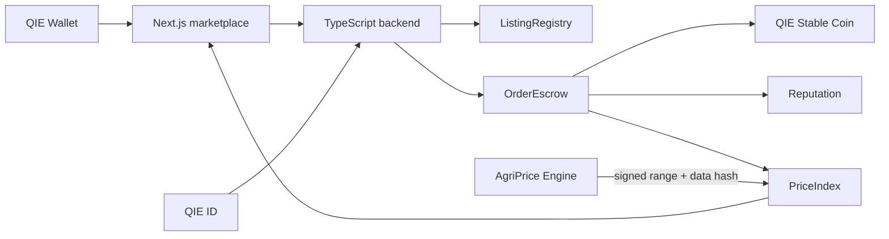

# FairHarvest QIE

FairHarvest is a farmer-to-consumer public marketplace on QIE Mainnet. Its MVP focuses on one crop category in one pilot region. The problem is price opacity: farmers often lack a transparent reference price while consumers cannot tell whether the price they pay fairly reflects the producer's share.

## Solution

FairHarvest publishes a transparent Fair Price Index from completed sales and signed AI price-range commitments. Farmers create public listings; buyers pay QIE Stable Coin into an escrow contract; delivery confirmation releases the farmer's proceeds minus a configurable platform fee capped at 2%. The lightweight, explainable AI Price Copilot shows a range, confidence, and data hash rather than an opaque single prediction.

## Architecture

## QIE component integration

| QIE component | FairHarvest use | MVP boundary |
|---|---|---|
| QIE Wallet | Authentication, transaction signing, buyer/farmer actions | Wallet connection and signed transactions |
| QIE ID | Farmer and merchant verification | Application-level verification hook |
| QIE Stable Coin | Escrow settlement and seller payout | Required payment token |
| QIEDex | Optional stablecoin conversion | Deferred integration |
| QIE Oracle / signed feed | Reference data for the Fair Price Index | Authorized signed AI commitments |
| QIE Mainnet | Production deployment and public verification | Required for submission |

## Repository layout

- `contracts/`: Solidity contracts and Hardhat configuration.
- `backend/`: TypeScript API scaffold for indexing and application orchestration.
- `frontend/`: Next.js marketplace scaffold.
- `ai-service/`: Python service boundary for the AgriPrice Engine.
- `docs/`: architecture and decision records.
- `scripts/`: deployment and operational scripts.
- `tests/`: test-suite placeholder.

## Configuration

Copy `.env.example` to `.env`, fill deployment values, and configure the QIE Mainnet RPC and explorer API key. The supplied Hardhat config defaults to the QIE Mainnet chain ID placeholder shown in the environment file; verify the current official network parameters before deployment.

The canonical oracle variables are `AI_ORACLE_PRIVATE_KEY`, `AI_ORACLE_ADDRESS`, and `PRICE_ORACLE_ADAPTER_ADDRESS`. Never commit `.env` or print the oracle private key.

## 90-day traction plan

**Days 1–30 — pilot readiness.** Select one crop and one region, recruit 10–20 farmers and two buyer groups, validate the listing fields, and publish an initial methodology for the Fair Price Index. Deploy to a test environment first, then harden the mainnet deployment checklist.

**Days 31–60 — monitored pilot.** Launch with a small set of verified listings, record completed sales, collect buyer and farmer feedback, and compare the AI range with realized prices. Track settlement completion, time-to-confirm, dispute rate, repeat buyers, and farmer share of the final price.

**Days 61–90 — repeatability.** Reach 50+ active farmers and 100+ completed orders in the pilot, publish weekly index updates and anonymized outcome summaries, resolve the top usability issues, and prepare a playbook for adding the next crop or region without changing the settlement guarantees.

## Development status

This repository is an original scaffold with the specified contract interfaces and documentation. Product business logic, production verification, audits, and deployment credentials must be completed and reviewed before use with real funds.
